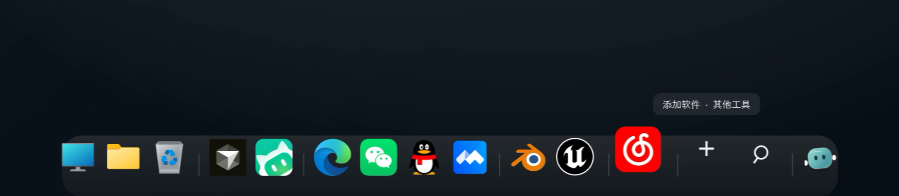
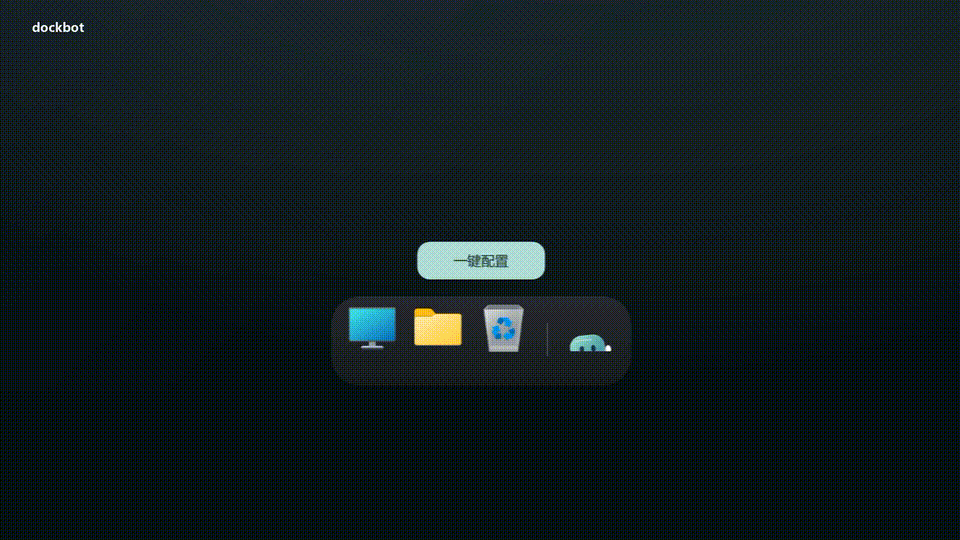
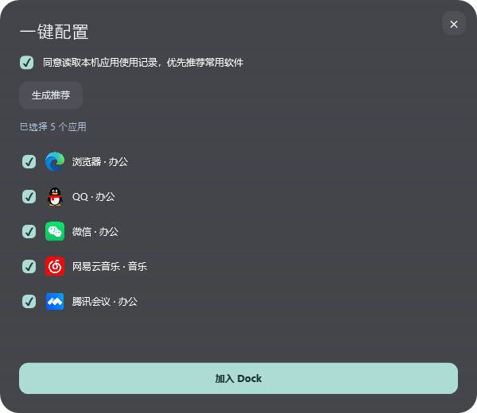
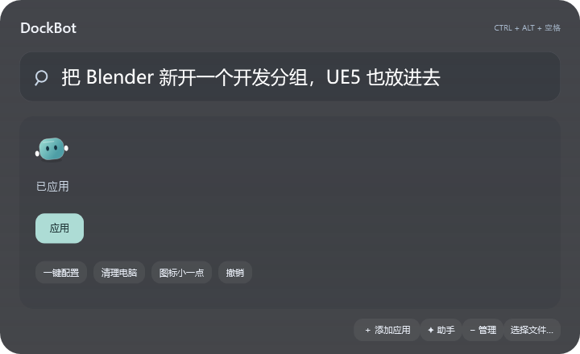
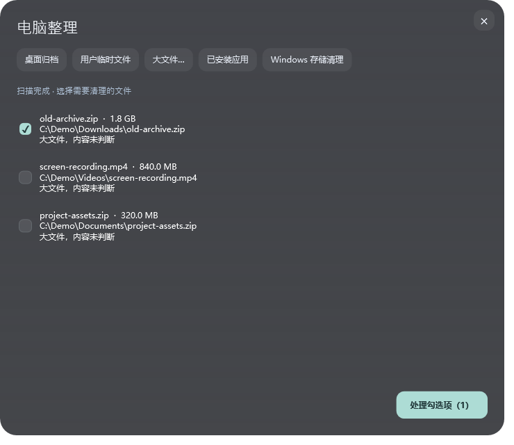

<div align="center">


# dockbot

### 从一个空 Dock，整理出自己的 Windows 桌面。

原生圆角玻璃 · 弹性拖放 · 流式扫描 · 本地助手 · 授权清理

[下载预览版](https://github.com/nanhudev/dockbot/releases) · [观看宣传片](https://github.com/nanhudev/dockbot/releases/download/v0.1.1-preview.1/DockBot-Promo.mp4) · [原生流程演示](https://github.com/nanhudev/dockbot/releases/download/v0.1.1-preview.1/DockBot-Demo.mp4)

</div>



**dockbot 是 Windows 桌面上的轻量启动与整理助手。** 底座收纳应用和网站，快捷键集中搜索，住在底座后面的小 Bot 帮你调整入口、顺序、分类和外观。

从空白开始：此电脑、文件、回收站，以及一键配置入口。选择自己的常用软件，之后再通过拖放、搜索和对话微调。桌面收纳和文件清理也在同一个入口里，需要处理的内容先展示，再由你勾选确认。

> 宣传片使用独立演示配置，软件图标用于展示交互；没有实际启动软件、读取系统使用记录或清理个人文件。

[](https://github.com/nanhudev/dockbot/releases/download/v0.1.1-preview.1/DockBot-Promo.mp4)

## 先看它怎么工作


| 入口 | 可以做什么 |
| --- | --- |
| 底部 Dock | 打开常用应用与网站，拖动排序，拖入添加，拖出移除 |
| 一键配置 | 生成常用应用候选，确认后一次加入并分类 |
| DockBot | 用一句话调整入口、顺序、分类、大小、风格与启动设置 |
| 全局搜索 | 用快捷键寻找应用、已索引文件及指定目录中的文件 |
| 电脑整理 | 桌面归档、临时文件、大文件、应用卸载与系统存储设置 |

## 1. 空底座，按需配置

第一次打开时没有预装的软件清单。点击 **一键配置**，从本机应用中选择要加入的入口。


- 读取系统应用使用记录是可选项，默认不勾选；授权后用于优先推荐常用软件。
- 使用记录留在本机，不上传。
- 推荐会过滤安装器、卸载器、驱动、运行库、许可证管理器等后台组件。
- 生成推荐后仍由你选择，不会把候选全部塞进 Dock。
- 扫描时显示小转圈与状态文字，完成或失败后停止。



## 2. 直接拖放，随手整理

**添加：** 把快捷方式或 EXE 拖进底座，也可以点加号搜索，或选择文件添加。

**排序：** 在底座里拖动调整顺序。手动调整后保留手动顺序；需要时再开启按使用习惯整理。

**移除：** 把入口拖出底座并松开。这里只移除固定入口，原软件和文件保留。按 Esc 或取消拖动时恢复原位。

**分类：** 应用按系统、AI、办公、开发、音乐、游戏、常用网站和其他工具组织，也能通过右键或对话调整。系统入口位于前面。

图标悬停使用连续弹簧反馈，排序时保留当前位置与速度。Bot 会参与入口搬动与移除的过渡；动画稳定后停止更新。

## 3. DockBot，一句话微调

小 Bot 平时在底座后面待机，鼠标靠近会稍微探出。点击它输入想做的操作，查看预览后应用。

| 想做的事 | 可以这样表达（把应用名换成你自己的） |
| --- | --- |
| 添加多个入口 | 帮我把应用 A 和应用 B 加入 Dock |
| 调整相对位置 | 把应用 A 放到应用 B 前面 |
| 建立分类区域 | 把这两个应用放到开发分组 |
| 移除入口 | 把应用 A 移出 Dock |
| 打开与关闭 | 打开应用 A / 关闭应用 A |
| 调整外观 | 图标小一点 / 大小调到 90% / 换成浅色主题 |
| 管理启动 | 设置开机自启动 / 关闭开机自启动 |
| 恢复配置 | 撤销刚才的操作 |



已识别的多个应用可以合并添加或归类，统一预览和应用；其中一项无效时不会只留下半组改动。开发分组在加入第一批对应应用后显示在底座上。

关闭应用会请求正常关闭窗口，保留软件自己的保存提示。配置撤销可恢复入口、排序、分组和外观等改动；不会撤销已打开／关闭的软件或文件清理。

## 4. 快捷键，随时搜索

按 **Ctrl + 空格** 唤出搜索。快捷键冲突时尝试 **Ctrl + Alt + 空格**。

- 搜索本机发现的应用、中文名、部分拼音和别名。
- 优先查询 Windows Search 索引中的文件。
- 未索引时，在个人文件夹及主动添加的目录中做有时间限制的浅层查找。
- 用方向键选择、回车打开、Esc 收起；也可以从搜索中添加或移除 Dock 入口。

搜索范围取决于 Windows 索引和添加的目录，不保证穷尽所有磁盘。文件查找不读取文档正文。

## 5. 网站也有自己的位置

可以把常用网页作为独立入口放进 **常用网站** 分区。对 DockBot 说“添加”并附上完整的 `https://` 地址即可。

少量内置网站别名可以直接匹配。遇到学校、机构或站点不明确的名称时，需要提供具体网址；不会凭模糊名字生成链接。网站通过系统默认浏览器打开。

## 6. 电脑整理，先看清再处理



| 功能 | 显示与处理方式 |
| --- | --- |
| 桌面归档 | 预览目标位置，把选中的桌面文件移动到按日期划分的归档文件夹，保留原有文件夹和程序 |
| 用户临时文件 | 仅列出用户临时目录中超过 7 天未修改、未访问的指定类型文件 |
| 大文件 | 选择本地文件夹，列出 ≥250 MB 的候选；大小不代表可以删除 |
| 已安装应用 | 列出可通过 Windows 卸载的应用和登记大小，交给系统再次确认 |
| Windows 存储 | 打开系统存储设置，由你选择更新缓存等项目 |

**扫描 → 勾选 → 确认 → 重新校验 → 处理 → 本地记录。** 默认没有文件获得清理授权。

执行时会复核路径、大小、修改时间和占用情况；变化、越界或无法访问的文件会跳过。系统目录、应用目录、程序、驱动及链接等不进入大文件清理候选。每轮扫描有时间和数量上限。

文件清理使用 Windows 回收站，不主动清空回收站；因此移入回收站后通常不会立即释放空间。桌面归档的移动清单及清理结果保存在本机，可用于核对和手动恢复。

## 7. 日常设置与入口维护

- 深色玻璃、浅色玻璃、石墨三种外观。
- 底座大小可调为 65%–140%。
- 自动收起、减少动态效果、桌面时钟小组件。
- 当前用户的开机自启动，可随时关闭。
- 可选本地点击次数和前台活跃时长统计，用于同类应用的使用习惯排序。
- 快捷方式解析后保留 EXE、参数和工作目录，尽量绑定实际程序。
- 根据原快捷方式、目录变化及安装目录检查入口；身份不符的同名文件不会自动接管旧入口。

程序任意跨盘迁移且没有可用线索时，需要重新定位。自动校验不会为找一个入口持续扫描所有磁盘。

## 安装与使用

直接下载 [DockBot.exe](https://github.com/nanhudev/dockbot/releases/download/v0.1.1-preview.1/DockBot.exe)，双击即可使用。需要完整说明与资源时，下载 Release 中的 ZIP。

也可以在 PowerShell 中执行一行，自动下载、校验、安装并启动：

```powershell
irm https://raw.githubusercontent.com/nanhudev/dockbot/main/Install-Online.ps1 | iex
```

首次打开只有系统入口。点击一键配置，选择应用，再通过拖放、搜索或 DockBot 调整；读取使用记录需要单独勾选。安装会创建开始菜单入口，个人设置会保留。

支持 Windows 10 / 11 与 .NET Framework 4.8，无需管理员权限、Python、GPU 或额外模型服务。当前为预览版本。

安装目录为 `%LOCALAPPDATA%\Programs\DockBot`；新配置保存在 `%LOCALAPPDATA%\DockBot`。从早期 FluidDock 升级时沿用原有 `%LOCALAPPDATA%\FluidDock` 数据，保留个人入口与偏好。

## 本地助手与隐私

DockBot 使用软件目录、别名规则和约 **17 KB** 的字符 n-gram 意图模型来规划有限的桌面操作。它有 19 类基础意图，组合指令通过受限计划执行，不是通用聊天模型。

没有识别到软件、存在多个安装入口或缺少参数时，会要求选择具体入口。当前训练数据为 274 条合成短句；分类分数没有经过真实人群校准，回归检查通过不代表所有表达都能理解。[实现、测试和已知限制](docs/assistant-design.md)。

不收集遥测，不上传文件或使用记录。新安装默认关闭使用统计、开机自启动与隐藏桌面图标；已有个人设置会保留。

## 构建与演示素材

```powershell
npm run build
npm test
npm run package
```

使用系统自带的 .NET Framework C# 编译器。可选运行 `python tools/train_intent.py` 重新训练模型。70 秒宣传片使用高清 WPF 演示录制、Remotion 动画设计与 FFmpeg 合成，原创配乐和制作说明见 [film/README.md](film/README.md)。

个人入口、绝对路径、使用记录、字体文件和软件图标缓存不提交到仓库。第三方软件标识归各自权利人所有。MIT License。
