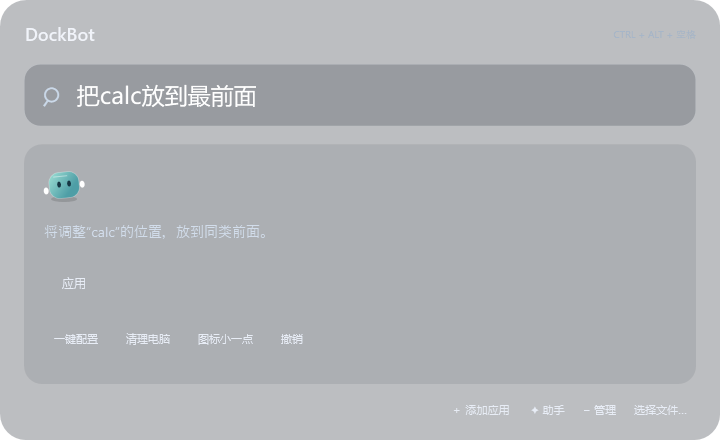

# FluidDock

简约的 Windows Dock，带一个住在底座后面的 DockBot。

原生 WPF · 磨砂玻璃 · 连续弹簧动效 · 本地意图识别



## 使用

从 [Releases](https://github.com/nanhudev/FluidDock/releases) 下载并解压。双击 `FluidDock.exe`，或右键用 PowerShell 运行 `Install.ps1` 安装到当前用户目录。无需管理员权限。

Windows 10 / 11，.NET Framework 4.8。当前原生界面在 Windows 桌面环境验证；这是预览版本。

- 拖入快捷方式或 EXE 添加；拖动排序；拖出底座松开移除；Esc 取消拖动。
- 点加号搜索软件；点末尾探头的 DockBot 输入指令。
- `Ctrl + 空格` 打开应用与文件搜索；快捷键被占用时尝试 `Ctrl + Alt + 空格`。
- 右键 → 一键配置，选择常用软件。读取 Windows 应用使用记录需要单独勾选同意。
- 右键 → 电脑整理，扫描后勾选要处理的文件，再确认。

可以告诉 DockBot：

```text
帮我把飞书加入
帮我加一个酸角洲
帮我打开微信
关掉腾讯会议
帮我把 um moodle 加入到 dock
把 si web 加入 dock
把 Blender 归到开发
把 Cubase 归到音乐
把 GPT 放到最前面
图标小一点
换成石墨风格
设置开机自启动
关闭开机自启动
一键配置
清理 C 盘
撤销
```

软件必须实际存在。没有找到时可拖入入口或选择软件目录。三角洲支持中文、拼音和部分拼写纠错；多个安装入口需要选择。添加、删除入口、排序、外观等先预览再应用。撤销针对 Dock 配置，不会撤销软件打开／关闭或文件清理。

## 电脑整理

- **桌面归档**：预览每个文件的目标位置，移入桌面下按日期创建的 `Dock 整理` 文件夹。保留原有文件夹与程序。
- **用户临时文件**：只列出超过 7 天未修改、未访问的 `.tmp/.temp/.log/.dmp`。占用或变化的文件会跳过。
- **大文件**：选择本地目录，列出 ≥250 MB 的个人文件。大小不代表可删除；默认全部不勾选。排除系统、应用、驱动目录及可执行文件等。
- **应用卸载**：列出可通过 Windows 卸载的应用及登记大小，交给系统再次确认。不会因为缺少使用记录就认定软件没用，不自动运行注册表中的卸载命令。
- **系统缓存**：打开 Windows 存储设置，在系统界面中自行选择更新缓存等项目。

文件清理使用 Windows 回收站，不主动清空回收站。移入回收站通常不会立即释放空间。每次处理的授权清单和结果保存在本机 `care-history`；桌面移动可根据记录还原。扫描不会自动执行清理。

## DockBot 的边界

DockBot 是专门管理 Dock 的离线助手，不是通用聊天大模型。规则、软件别名、路径解析与约 **17 KB** 的字符 n-gram 意图分类模型协作；无需模型下载、Python、GPU 或网络推理服务。

目前 19 类意图、274 条合成训练样本。置信度是分类分数，未经人群校准；回归用例通过不等于任意说法都能理解。不能识别、存在歧义或缺少参数时，请选择具体入口或补充表达。[设计与 bad case](docs/assistant-design.md)。

UM Moodle、SI Web 是内置的澳门大学网站别名。其他学校的 Moodle 请提供网址；其他网站可粘贴完整 `https://` 地址。不会凭模糊网站名编造网址。

全局文件搜索优先使用 Windows Search 索引。未索引时在个人文件夹和主动添加的目录中做有时间限制的浅层查找；不保证搜索到所有磁盘的每个文件。入口迁移优先靠目录变化、原快捷方式和安装目录修复；任意跨盘移动且没有线索时需要重新定位。

## 隐私与默认项

配置和记录仅保存在 `%LOCALAPPDATA%\FluidDock`。分发版本默认关闭使用统计、自动启动和隐藏桌面图标；个人已有设置会保留。Windows 使用记录仅在一键配置的复选框获同意后读取。本项目不收集遥测、不上传文件、不读取文档正文。

安装版程序位于 `%LOCALAPPDATA%\Programs\FluidDock`。开启自启动时创建当前用户的启动快捷方式。关闭自启动会移除该入口。

## 构建

```powershell
.\build.ps1 -Test
python .\tools\train_intent.py  # 可选：重新训练嵌入模型
.\tools\package.ps1
```

使用系统自带的 .NET Framework C# 编译器，不依赖 .NET SDK。`--self-test --data-dir <目录>` 执行回归测试；`--smoke-ui` 在隔离数据目录内验证原生界面流程并退出。请勿将个人的 `apps.json`、使用记录、图标缓存或清理记录提交到仓库。

第三方软件图标从本机安装文件提取，归各自权利人所有；仓库与安装包不附带个人软件资产。MIT License。
